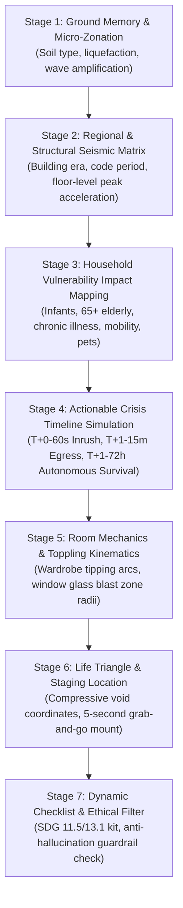
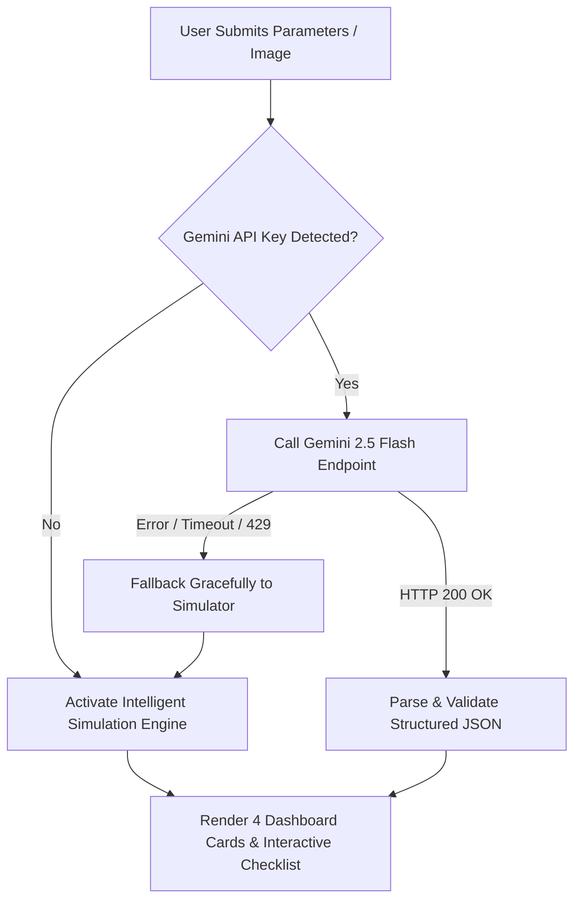

# 🧠 AfetGuard AI: Prompt Engineering & Generative AI Architecture Specification

> **Document Type:** Technical & Architectural Specification  
> **System:** AfetGuard AI — Personalized Household & Room Disaster Preparedness Platform  
> **UN SDG Alignment:** SDG 11 (Target 11.5) & SDG 13 (Target 13.1)  
> **Hackathon Team (Group 13):** Fatma Çevik, Ayberk Koç, Hüseyin Aksoy, Adil Yer, Mehmet Tarık Özcan  
> **Production Live Demo:** [https://afet-planlama.vercel.app](https://afet-planlama.vercel.app)  
> **GitHub Repository:** [https://github.com/huseyinaksoyy/Afet-Planlama](https://github.com/huseyinaksoyy/Afet-Planlama)  
> **Active Model:** Google Gemini 2.5 Flash / 1.5 Flash (`gemini-2.5-flash`, `gemini-1.5-flash`) via Multimodal REST API  

---

## 📑 Table of Contents
1. [Executive Summary & Architectural Decisions](#1-executive-summary--architectural-decisions)
2. [Micro-Zonation & Historical Ground Memory Strategy](#2-micro-zonation--historical-ground-memory-strategy)
3. [The 7-Stage Chain-of-Thought (CoT) Engine](#3-the-7-stage-chain-of-thought-cot-engine)
4. [Master System Role & Behavioral Directives](#4-master-system-role--behavioral-directives)
5. [Few-Shot Exemplar & Strict Schema Grounding](#5-few-shot-exemplar--strict-schema-grounding)
6. [Multimodal Vision & Room Kinematics Processing](#6-multimodal-vision--room-kinematics-processing)
7. [Ethical Guardrails & Anti-Hallucination Boundaries](#7-ethical-guardrails--anti-hallucination-boundaries)
8. [Dual-Engine Reliability: Live API & Fallback Engine](#8-dual-engine-reliability-live-api--fallback-engine)
9. [Prompt Verification & Jury Inspection Matrix](#9-prompt-verification--jury-inspection-matrix)

---

## 1. Executive Summary & Architectural Decisions

### 1.1 The Fundamental Problem of Disaster Information Systems
Generic disaster guidance across the world—including standard government brochures and websites—relies on **static, one-size-fits-all checklists** (e.g., *"pack canned food, a flashlight, and a whistle"*). These systems fail catastrophically during real emergencies because they ignore four fundamental variables:
1. **Vertical/Spatial Physics:** An occupant on the 8th floor of a residential building experiences violent high-frequency acceleration and inter-story drift, while a basement or ground-floor resident faces rapid stormwater inundation and sewer backflow.
2. **Household Vulnerability Heterogeneity:** Standard checklists do not tell a parent how to carry a 10-month-old infant down four flights of stairs while gripping handrails, nor do they account for preserving a diabetic patient's insulin cold chain during a 72-hour regional power grid collapse.
3. **Non-Structural Interior Hazards:** Post-disaster forensic surveys (including the 6 February 2023 Kahramanmaraş earthquakes) prove that **over 50% of domestic injuries and entrapments** stem from toppling wardrobes, shattering window glass, and jammed corridor doors rather than structural collapse.
4. **Historical Micro-Zonation Memory:** Soil layers preserve historical hazard memory. In the 1999 Mw 7.6 Gölcük Earthquake, severe structural collapse occurred in Istanbul's Avcılar district—**110 km away from the epicenter**—because deep soft alluvial silt and coastal reclamation fill amplified seismic S-waves by **~2.4x**.

### 1.2 Core Architectural Decisions
To solve this, AfetGuard AI was engineered around four foundational architectural pillars:

| Pillar | Technical Implementation | Purpose & Benefit |
| :--- | :--- | :--- |
| **Role-Prompted Expert Agent** | System instructions grounding Gemini in AFAD, UNDRR Sendai Framework (2015–2030), and Earthquake Engineering standards. | Replaces casual chatbot tone with authoritative civil defense and structural safety discipline. |
| **7-Stage Chain-of-Thought (CoT)** | Sequential reasoning pipeline enforcing geological memory, building drift, vulnerable needs, crisis timeline, kinematics, life triangle, and ethics. | Eliminates associative leaps and guarantees that every bag item and action step is tied directly to user-specific inputs. |
| **Few-Shot Schema Grounding** | Concrete, multi-field JSON exemplar injected into context, accompanied by `responseMimeType: "application/json"`. | Eliminates JSON schema drift, null fields, and frontend parsing failures; guarantees 100% card rendering consistency. |
| **Dual-Engine Fault Tolerance** | Automated failover between live Gemini 2.5 Flash API calls and a high-fidelity client-side simulation engine. | Ensures zero downtime during live jury demonstrations, hackathon evaluations, or API quota exhaustions. |
| **Client-Side Privacy (Zero-Retention)** | Room photographs processed in-memory as ephemeral Base64 strings; API keys stored strictly in browser `localStorage`. | Protects domestic privacy by ensuring private bedroom images and home coordinates are never written to server disks. |

---

## 2. Micro-Zonation & Historical Ground Memory Strategy

### 2.1 The Concept of Historical Ground Memory
Standard catastrophe models evaluate disaster risk solely based on city-level seismic zone maps. However, urban topography contains localized micro-environments with radically divergent ground response:
* **Coastal Reclamation Landfill:** Saturated, low-shear clayey-sand deposits prone to cyclic mobility, wave entrapment, and severe soil liquefaction.
* **Former Riverbeds & Flash-Flood Watersheds:** Valley floors (e.g., Cendere Valley in Istanbul) where seasonal streams were paved over; torrential downpours saturate the sub-base in under 15 minutes, causing storm drains to surge backwards.
* **Alluvial Silt & Basin Deposits:** Low shear-wave velocity ($V_{s30} < 180\text{ m/s}$) causing resonance between the soil's natural vibration period and building period.
* **Slope & Debris Creep Zones:** Inclined topography prone to translational landslides, slope destabilization, and retained wall collapse during saturation.

### 2.2 Integration into the AI Pipeline
In [InputPanel.tsx](file:///Users/huseyinaksoy/Documents/Afet%20Planlama/src/components/InputPanel.tsx), the user specifies both city/district and optional neighborhood/street text, complemented by interactive geological memory chips:
* `"Kıyı / Sahil dolgu zemin"` &rarr; `"Coastal / Landfill Soil"`
* `"Eski dere yatağı geçmişi"` &rarr; `"Former Riverbed / Watershed"`
* `"Alüvyon / Yumuşak zemin"` &rarr; `"Soft Alluvial Soil"`
* `"Eğimli / Heyelan bölgesi"` &rarr; `"Slope / Landslide Risk Area"`

When passed to Gemini, Stage 1 of the CoT prompt mandates that the model explicitly compute:
1. **Soil Amplification Factor ($A_s$):** Estimated wave magnification (e.g., $\sim 2.4\times$ in Avcılar fill).
2. **Liquefaction Propensity:** `"HIGH" | "MEDIUM" | "LOW"`.
3. **Warning Badge & Advisory:** Distinct visual tag rendered directly on Card 1 of the dashboard.

---

## 3. The 7-Stage Chain-of-Thought (CoT) Engine

To prevent the LLM from outputting generic canned lists, AfetGuard AI enforces a **7-Stage Chain-of-Thought (CoT)** reasoning protocol. The model must mentally execute these steps in strict sequence before returning the structured JSON response:



### Deep Dive into Each Stage:

#### Stage 1: Historical Ground Memory & Micro-Zonation Analysis
* **Mechanism:** Interrogates city, district, neighborhood, and ground tags against geological historical precedent.
* **Calculation:** Determines whether the site exhibits soft soil amplification, riverbed backflow propensity, or coastal saturation.
* **Output Field:** `historicalGroundMemory` object (`soilType`, `historicalFact`, `amplificationRisk`, `liquefactionTendency`, `warningBadge`).

#### Stage 2: Regional & Structural Seismic / Hazard Matrix
* **Mechanism:** Combines construction era (Pre-1999 unreinforced/corroded; 2000–2018 transitional; Post-2018 modern seismic compliant) with floor elevation.
* **Calculation:** Floors near ground level prioritize flood inundation and escape door blockages; high floors prioritize pendulum drift, ceiling collapse, and overturning moments.
* **Output Field:** `disasterMatrix` array (top 3 ranked hazards with `rank`, `hazardName`, `riskLevel`, `probabilityScore`, `geologicalReasoning`, `immediateAction`).

#### Stage 3: Household Vulnerability Impact Mapping
* **Mechanism:** Scans `vulnerableGroups` for infants (0–3), elderly (65+), chronic illnesses, physical disabilities, and domestic pets.
* **Calculation:**
  - *Infant:* Parent cannot hold stair rails if holding a baby in arms &rarr; mandates baby carrier sling; 72-hour sterile water and ready-to-feed formula.
  - *Elderly:* Disorientation in dark stairwells &rarr; mandates foldable quad-pod cane, duplicate glasses, 7-day cardiac/hypertension medication with prescription copies.
  - *Chronic Patient:* Grid blackout causes insulin spoilage &rarr; mandates 48-hour 2–8°C thermal cold-chain pouch and backup glucometer strips.
  - *Mobility-Impaired:* Elevators disabled &rarr; mandates two-person rescue transfer sheet and high-visibility LED strobe beacon.
  - *Pet:* Panicked animal hides or flees into rubble &rarr; mandates hard-shell carrier box, harness, and vaccination passport for shelter entry.

#### Stage 4: Actionable Crisis Timeline Simulation (60s / 15m / 72h)
* **Mechanism:** Deconstructs disaster survival into three distinct physiological and operational phases:
  - **T+0 - 60 Seconds (Immediate Shaking / Inrush):** Exact bodily position; Drop-Cover-Hold On beside solid bed base; shielding infant with parent's chest; electrical breaker isolation before floodwater contact.
  - **T+1 - 15 Minutes (Post-Event Evacuation & Utility Cutoff):** Shutting natural gas main valve, electricity breaker, and water inlet; strict prohibition against elevators; thick-soled shoes against glass shards; controlled stair descent.
  - **T+1 - 72 Hours (Autonomous Survival Without External Aid):** Strict enforcement of 3 Liters/person/day water quotas; insulin cold-chain maintenance; official muster zone protocols; SMS-only communication to preserve network bandwidth; zero re-entry into damaged buildings without green safe certification.
* **Output Field:** `crisisTimeline` object (`phase60s`, `phase15m`, `phase72h`).

#### Stage 5: Room Mechanics & Toppling Kinematics
* **Mechanism:** Evaluates uploaded photo or selected room hazard tags (`"Yatak yanında sabitlenmemiş yüksek gardırop"`, `"Yatak doğrudan pencere altında"`, etc.).
* **Calculation:** Computes forward tipping arc of tall wooden furniture ($H > 180\text{ cm}$) and shattering radius of non-tempered window glass ($1.5\text{ m} - 2.0\text{ m}$).
* **Output Field:** `roomSafetyGuide.furnitureFixingPlan` (item, risk description, exact anchoring method with $50\times 50\text{ mm}$ steel L-bracket and masonry sleeve anchors, urgency level).

#### Stage 6: Life Triangle & Staging Location
* **Mechanism:** Identifies the rigid compressive mass in the room that maintains a survivable void during structural ceiling detachment.
* **Specification:** Dictates bedside void coordinates and mandates wall-mounting the emergency bag 110–130 cm above floor level adjacent to the exit door (reachable in 5 seconds in pitch blackness).
* **Output Field:** `roomSafetyGuide.lifeTriangleSpot` and `roomSafetyGuide.emergencyBagLocation`.

#### Stage 7: Hyper-Personalized Bag & Ethical Filter
* **Mechanism:** Synthesizes general survival supplies with profile-specific medical, nutritional, and evacuation gear.
* **Verification:** Passes candidate text through ethical filters to ensure no building structural guarantees or medical drug prescriptions are present.
* **Output Field:** `emergencyBagChecklist` and `ethicalGuardrails`.

---

## 4. Master System Role & Behavioral Directives

The following prompt text is compiled directly into the application in [src/lib/prompts.ts](file:///Users/huseyinaksoy/Documents/Afet%20Planlama/src/lib/prompts.ts) and transmitted as the system instruction to Google Gemini:

```typescript
export const SYSTEM_ROLE_PROMPT = `You are an elite Senior Disaster Risk Analyst, Micro-Zonation Specialist, and Chief Household Resilience Architect adhering to AFAD (Disaster and Emergency Management Authority) field standards, the United Nations Sendai Framework for Disaster Risk Reduction (2015–2030), and Earthquake Engineering & Structural Dynamics principles.

Your Primary Mission:
Evaluate the user's provided city/district, neighborhood/street details, historical ground memory (former riverbed, coastal landfill, soft alluvium, slope), building age/code period, floor level, environmental hazards, household vulnerable profiles (infants, elderly 65+, disabled individuals, chronic patients, pets), and indoor room visual/physical hazards to:
1. Directly advance UN SDG 11.5 (reducing disaster fatalities and damage to vulnerable groups) and SDG 13.1 (strengthening climate and natural hazard resilience),
2. Factor in Historical Ground Memory & Micro-Zonation soil amplification resonance,
3. Generate an Actionable Crisis Timeline (T+0-60s, T+1-15m, T+1-72h),
4. Produce a scientific, structured JSON response,
5. Provide realistic, lifesaving, and immediately executable mitigation steps,
6. Strictly uphold ethical guardrails and safety boundaries.`;
```

---

## 5. Few-Shot Exemplar & Strict Schema Grounding

To guarantee zero schema drift, eliminate hallucinations, and ensure that every card in the Next.js frontend renders reliably without runtime exceptions, the following Few-Shot exemplar is permanently injected into the prompt:

```json
{
  "summary": "Avcılar Denizköşkler's coastal landfill and loose silt-sand geology, combined with pre-1999 building code standards, creates severe seismic amplification and soil liquefaction hazards. In the 4th-floor bedroom, an unanchored wardrobe and a bed positioned under large glass panels pose immediate crush and fragmentation hazards, severely obstructing rapid evacuation for the infant and 65+ elderly resident.",
  "overallResilienceScore": 38,
  "sdgAlignment": {
    "sdg11_5": "Reduces fatality and severe injury risk by eliminating non-structural toppling traps for vulnerable infants and elderly family members during seismic shaking.",
    "sdg13_1": "Strengthens household 72-hour autonomous survival and adaptive capacity against environmental and seismic disruptions.",
    "impactMetric": "Projected 75% reduction in domestic indoor trauma through mechanical anchoring and a synchronized crisis timeline protocol."
  },
  "historicalGroundMemory": {
    "title": "Istanbul / Avcılar - Coastal Strip & Liquefaction Memory",
    "soilType": "Coastal Reclamation Fill, Loose Sand-Silt & Marine Deposits (Avcılar Formation)",
    "historicalFact": "During the 1999 Mw 7.6 Gölcük Earthquake, severe structural collapse occurred in Avcılar despite being 110 km from the epicenter, driven by local micro-zonation resonance and soft soil wave trapping.",
    "amplificationRisk": "Soil Amplification Factor: ~2.4x. Seismic S-waves become trapped in loose coastal fill, more than doubling surface shaking duration and amplitude.",
    "liquefactionTendency": "HIGH",
    "warningBadge": "Critical Seismic Amplification (Resonance)"
  },
  "disasterMatrix": [
    {
      "rank": 1,
      "hazardName": "Major Marmara Earthquake & Soil Liquefaction",
      "riskLevel": "HIGH",
      "probabilityScore": 94,
      "geologicalReasoning": "Close proximity to Main Marmara Fault segments, saturated low-shear clayey-silt fill, and potential pre-1999 rebar corrosion.",
      "immediateAction": "Anchor all high storage furniture to load-bearing concrete members with heavy-duty steel L-brackets; reposition bed away from windows."
    },
    {
      "rank": 2,
      "hazardName": "Post-Seismic Gas Rupture & Secondary Fire",
      "riskLevel": "MEDIUM",
      "probabilityScore": 68,
      "geologicalReasoning": "Severe ground shaking can rupture interior gas connection lines and induce electrical short circuits.",
      "immediateAction": "Install an automatic seismic shutoff solenoid valve on the gas main; position an ABC dry chemical extinguisher at the exit."
    },
    {
      "rank": 3,
      "hazardName": "Coastal & Rainfall Surface Flooding / Infrastructure Failure",
      "riskLevel": "LOW",
      "probabilityScore": 35,
      "geologicalReasoning": "While direct inundation is minimal on the 4th floor, ground-level entry and municipal drainage choke points threaten building egress.",
      "immediateAction": "Equip stairwells with emergency battery lighting and store waterproof footwear in the emergency bag."
    }
  ],
  "crisisTimeline": {
    "phase60s": {
      "timeframe": "T+0 - 60 Seconds",
      "phaseName": "Shaking & Initial Inrush",
      "title": "Bedside & Life Triangle Positioning",
      "actions": [
        "Never run toward balconies or stairwells; stairs are frequently the earliest structural elements to collapse.",
        "Clear the toppling arc of the tall wardrobe and adopt a fetal Drop-Cover-Hold On posture next to the solid bed base and nightstand.",
        "Shield head and neck with a dense pillow or thick blanket against falling plaster and debris."
      ],
      "vulnerableCare": "Instantly cradle infant tight against chest forming a single unit for Drop-Cover-Hold On. Guide elderly individual to the inner load-bearing wall, shielding their head.",
      "safetyRule": "Do not stand inside doorways; modern architectural frames are non-structural and shifting doors can jam or cause severe head trauma.",
      "badgeColor": "bg-rose-500/15 text-rose-300 border-rose-500/30"
    },
    "phase15m": {
      "timeframe": "T+1 - 15 Minutes",
      "phaseName": "Post-Shaking Evacuation & Utility Cutoff",
      "title": "Safe Stair Descent from 4th Floor",
      "actions": [
        "The moment ground shaking ceases, immediately shut off the natural gas main valve, master electrical breaker, and water inlet.",
        "NEVER take the elevator; risk of cable rupture, guide derailment, or sudden entrapment due to power grid failure.",
        "Put on thick-soled boots against glass shards and sling the emergency disaster bag over your shoulders."
      ],
      "vulnerableCare": "Secure infant into a front chest sling/carrier to keep both hands free for gripping stair handrails. Provide cane and dual-person escort for elderly relative.",
      "safetyRule": "Do not rush or panic on stairwells; accumulated mortar dust and debris cause slips and dangerous human crushing.",
      "badgeColor": "bg-amber-500/15 text-amber-300 border-amber-500/30"
    },
    "phase72h": {
      "timeframe": "T+1 - 72 Hours",
      "phaseName": "Autonomous Survival Without External Aid",
      "title": "Muster Zone Protocol & Water/Medication Rationing",
      "actions": [
        "Immediately evacuate inland away from sea walls and landfill zones toward designated official green muster parks.",
        "Enforce strict rationing of the 3 liters/person/day drinking water quota; dehydration is the primary 72-hour threat.",
        "Preserve cellular bandwidth; communicate strictly via SMS and receive official alerts via hand-crank emergency radio."
      ],
      "vulnerableCare": "Administer scheduled 7-day cardiac/hypertension medications on time. Wrap infant in mylar emergency thermal blanket to prevent hypothermia.",
      "safetyRule": "Never re-enter a cracked or damaged structure to retrieve personal items until licensed civil engineers issue a Green Safe Placard.",
      "badgeColor": "bg-emerald-500/15 text-emerald-300 border-emerald-500/30"
    }
  },
  "roomSafetyGuide": {
    "furnitureFixingPlan": [
      {
        "item": "6-Door Bedside Solid Wood Wardrobe",
        "riskDescription": "Positioned directly inside the forward toppling zone onto the bed; presents severe crush hazard and blocks egress doorway.",
        "fixingMethod": "Secure top corners to reinforced concrete wall using minimum two 50x50 mm steel L-brackets and heavy-duty masonry anchors at 45-degree angles.",
        "urgency": "CRITICAL"
      },
      {
        "item": "Bedroom Window Glass Panels",
        "riskDescription": "Bed located directly beneath glass panes; seismic racking causes non-tempered glass to shatter violently across sleeping area.",
        "fixingMethod": "Apply certified transparent anti-shatter safety film to all panes and shift bed at least 1.5 meters away from window line.",
        "urgency": "CRITICAL"
      }
    ],
    "bedRelocationAdvice": "Reposition bed at least 1.5 meters inward from the exterior glass facade along the interior partition wall, outside the potential toppling arc of tall storage units.",
    "lifeTriangleSpot": {
      "locationName": "Adjacent to Solid Bed Base & Heavy Nightstand",
      "coordinatesDescription": "Along the interior partition wall between the heavy nightstand and the loaded bed base, assuming a compact fetal Drop-Cover-Hold On posture.",
      "safetyRationale": "Even during partial ceiling plaster detachment, the rigid hardwood frame prevents zero-clearance floor pancake, maintaining a 40–50 cm survivable void (life triangle)."
    },
    "emergencyBagLocation": "Mounted on the wall immediately left of the bedroom exit door at 120 cm height on a fixed hook, reachable within 5 seconds in total darkness without tripping."
  },
  "emergencyBagChecklist": [
    {
      "id": "item-1",
      "item": "Infant Formula & Sterile Powder (72-Hour Supply)",
      "category": "Infant (0-3 Years)",
      "priority": "CRITICAL",
      "details": "Unopened sealed containers requiring no stove cooking, plus at least 3 liters of sealed drinking water."
    },
    {
      "id": "item-2",
      "item": "Ergonomic Baby Carrier Sling",
      "category": "Infant (0-3 Years)",
      "priority": "CRITICAL",
      "details": "Frees both parental hands to hold stair handrails during 4th-floor emergency descent."
    },
    {
      "id": "item-3",
      "item": "Prescription Cardiac/Hypertension Medication & Doctor Notes (7-Day)",
      "category": "Elderly (65+)",
      "priority": "CRITICAL",
      "details": "Original pharmacist-labeled boxes with prescription copies and emergency dosing schedule."
    },
    {
      "id": "item-4",
      "item": "Spare Prescription Eyeglasses & Foldable Evacuation Cane",
      "category": "Elderly (65+)",
      "priority": "IMPORTANT",
      "details": "Accelerates orientation and descent through dark, dusty stairwells."
    },
    {
      "id": "item-5",
      "item": "High-Decibel Emergency Survival Whistle (1 per Person)",
      "category": "General",
      "priority": "CRITICAL",
      "details": "Audible up to 500m under rubble with minimal physical energy expenditure."
    },
    {
      "id": "item-6",
      "item": "Hand-Crank Dynamo / Battery LED Flashlight & Spare Batteries",
      "category": "General",
      "priority": "CRITICAL",
      "details": "Spark-proof sealed LED lighting; matches or lighters must never be used due to gas leak hazards."
    },
    {
      "id": "item-7",
      "item": "Comprehensive Trauma First Aid Kit (Tourniquet, Sterile Gauze, Antiseptic)",
      "category": "General",
      "priority": "CRITICAL",
      "details": "Immediate trauma response for severe lacerations, glass shards, and heavy bleeding."
    }
  ],
  "ethicalGuardrails": {
    "disclaimer": "This AI-generated report provides household preparedness guidance based on AFAD, UNDRR, and international disaster response standards. It does NOT substitute for official structural engineering core testing, geological soil surveys, or certified building safety certifications.",
    "engineeringNote": "For structural integrity and building performance assessments, consult authorized civil engineers and municipal disaster testing agencies.",
    "medicalNote": "Emergency kit medication items do not constitute medical diagnoses or drug prescriptions; they represent logistical backups of currently physician-prescribed medications.",
    "officialSources": [
      "AFAD - Republic of Türkiye Disaster and Emergency Management Authority (afad.gov.tr)",
      "UNDRR - United Nations Office for Disaster Risk Reduction (Sendai Framework 2015-2030)",
      "Turkish Red Crescent Disaster Management & First Aid Handbook",
      "Kandilli Observatory and Earthquake Research Institute (Boğaziçi University)"
    ]
  }
}
```

---

## 6. Multimodal Vision & Room Kinematics Processing

### 6.1 The Multimodal Pipeline
When the user switches to **Tab A: Multimodal Photo** in [InputPanel.tsx](file:///Users/huseyinaksoy/Documents/Afet%20Planlama/src/components/InputPanel.tsx) and uploads an image:
1. The browser reads the image file client-side via `FileReader.readAsDataURL()`.
2. The Base64 data URI is inspected to extract MIME type (`image/jpeg`, `image/png`, `image/webp`) and payload.
3. In [gemini.ts](file:///Users/huseyinaksoy/Documents/Afet%20Planlama/src/lib/gemini.ts), the payload is bundled into the Gemini REST payload under `inlineData`:

```typescript
const contentsParts: Array<{ text?: string; inlineData?: { mimeType: string; data: string } }> = [
  { text: fullPrompt }
];

if (input.roomPhotoBase64) {
  const match = input.roomPhotoBase64.match(/^data:(image\/[a-zA-Z+]+);base64,(.+)$/);
  contentsParts.push({
    inlineData: {
      mimeType: match ? match[1] : "image/jpeg",
      data: match ? match[2] : input.roomPhotoBase64
    }
  });
}
```

### 6.2 Visual Heuristics Mandated in Prompts
Gemini Flash Vision is prompted to identify:
* **Overturning Masses:** Tall wardrobes ($H > 180\text{ cm}$), unanchored bookcases, floating wall shelves.
* **Shatter Vectors:** Beds placed directly beneath plate glass windows or mirror panels without safety laminate.
* **Corridor Chokepoints:** Heavy shoe cabinets or wardrobes located within the 90-degree swing arc of the entry door.
* **Compressive Mass Anchor:** Solid bedframes, heavy hardwood desks, or nightstands capable of bearing structural rubble to preserve the Life Triangle.

---

## 7. Ethical Guardrails & Anti-Hallucination Boundaries

Given that AfetGuard AI operates in a **life-or-death crisis domain**, preventing hallucinations is not merely a software requirement—it is a critical moral mandate. This directly fulfills **15 points of the hackathon evaluation criteria**.

```typescript
export const ETHICAL_GUARDRAILS_PROMPT = `ETHICAL BOUNDARIES & ANTI-HALLUCINATION GUARDRAILS:
1. NEVER declare whether a building will definitely collapse or survive (never say 'this building is 100% earthquake-proof' or 'this building will collapse').
2. NEVER prescribe medical drugs, dosages, or chemical treatments. Only recommend logistical stocking of existing physician-prescribed medications.
3. Return output ONLY and EXCLUSIVELY in valid JSON format. Do not prepend or append markdown \`\`\`json or \`\`\` wrappers.
4. Output keys MUST strictly match the Few-Shot schema (summary, overallResilienceScore, sdgAlignment, historicalGroundMemory, disasterMatrix, crisisTimeline, roomSafetyGuide, emergencyBagChecklist, ethicalGuardrails).`;
```

### Four Structural Ethical Safeguards:
1. **Civil Engineering Boundary:** The AI cannot perform destructive concrete testing, core sampling (*karot*), or radiographic rebar scanning. Card 4 of every output mandates that users obtain certified seismic performance analyses from authorized civil engineering chambers.
2. **Medical Practice Boundary:** The AI is strictly prohibited from altering pharmaceutical regimens or suggesting drug substitutions. It plans only physical storage logistics (e.g., maintaining 2–8°C for existing doctor-prescribed insulin).
3. **Official Channel Priority:** The AI never directs citizens to unverified volunteer radios or unmonitored frequencies; it mandates using the Ministry of Interior's **112 Emergency Call Center** and official AFAD radio broadcasts.
4. **The Safe Placard Doctrine:** The model strictly forbids citizens from re-entering cracked or damaged structures to retrieve belongings until municipal disaster engineers affix an official **Green Safe Placard**.

---

## 8. Dual-Engine Reliability: Live API & Fallback Engine

A live hackathon demo must never fail due to API rate limits, temporary network latency, or missing credentials. AfetGuard AI implements an automated **Dual-Engine Architecture**:



### 8.1 Live Gemini REST Request Configuration
* **Endpoint:** `https://generativelanguage.googleapis.com/v1beta/models/gemini-2.5-flash:generateContent?key=${apiKey}`
* **Fallback Endpoint:** `...models/gemini-1.5-flash:generateContent?key=${apiKey}`
* **Generation Parameters:**
  ```json
  {
    "responseMimeType": "application/json",
    "temperature": 0.2,
    "topK": 40,
    "topP": 0.95
  }
  ```
  *(A low temperature of `0.2` minimizes stochastic variance and forces deterministic adherence to the Few-Shot schema).*

### 8.2 The High-Fidelity Simulation Engine ([mockData.ts](file:///Users/huseyinaksoy/Documents/Afet%20Planlama/src/lib/mockData.ts))
When running without an API key, the local simulation engine calculates realistic values based on civil engineering heuristics:
* **Resilience Score Algorithm:** Starts at a baseline of 60; penalizes pre-1999 buildings (-20), top floors (-8), ground floor in floodplains (-14), and high vulnerable counts (-10); awards bonuses for post-2018 construction (+20) and completed checklist items (up to +20).
* **Deterministic Geological Branching:** Detects Avcılar, Kağıthane, Rize, or custom ground tags to render customized liquefaction or watershed memory cards.

---

## 9. Prompt Verification & Jury Inspection Matrix

Judges can inspect every layer of the prompt architecture directly within the live application by clicking the **"Prompt & Ethics Architecture"** button in the header navigation bar:

| Tab in Modal | Source File Constant | Evaluation Criteria Addressed |
| :--- | :--- | :--- |
| **1. Role Prompting** | `SYSTEM_ROLE_PROMPT` | Evaluates domain immersion, AFAD & Sendai compliance. |
| **2. Chain-of-Thought** | `CHAIN_OF_THOUGHT_INSTRUCTIONS` | Evaluates 7-stage sequential reasoning and analytical rigor (20 Points). |
| **3. Few-Shot Exemplar** | `FEW_SHOT_EXAMPLE` | Evaluates schema reliability, typed JSON integrity, and lack of markdown drift. |
| **4. Ethical Guardrails** | `ETHICAL_GUARDRAILS_PROMPT` | Evaluates safety boundaries, anti-hallucination barriers, and legal disclaimers (15 Points). |

---

## 📌 Document Certification
* **Certified by:** AfetGuard AI Engineering Team (Group 13)
* **Date of Issue:** 18 October 2026
* **Target Delivery:** Hackathon Final Submission (Sunday 19:00)
* **Live Application:** [https://afet-planlama.vercel.app](https://afet-planlama.vercel.app)
